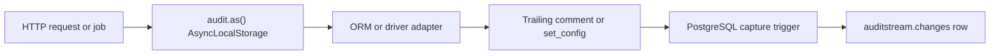

# @auditstream/node

Actor context propagation, application event logging, history helpers, and web framework integrations for [Auditstream](https://github.com/auditstream/auditstream).

`@auditstream/node` tracks who initiated each request with `AsyncLocalStorage`. ORM adapters read that scope and pass it to PostgreSQL triggers.

## Install

```sh
pnpm add @auditstream/node
```

Framework subpaths have optional peer dependencies. Install only the framework your app uses:

```sh
pnpm add @auditstream/node express
pnpm add @auditstream/node hono
pnpm add @auditstream/node next
```

## Supported versions

| Dependency | Supported in v0.1 |
| --- | --- |
| Node.js | `22.12` or newer (CI tests `22`, `24`, and `26`) |
| PostgreSQL | `15` to `19` |
| Prisma | `@prisma/client` `7.1` or newer within `7.x` (Prisma 6 is unsupported; Prisma 8 follows its stable release; the `prisma` CLI is never a peer) |
| Drizzle | `0.45` and `1.x` |
| Runtimes | Node.js (reference), Bun and Deno (tested in CI), Cloudflare Workers (`nodejs_als` flag or compatibility date `2026-08-04` or later) |

`@auditstream/node` is ESM-only so every package shares one `AsyncLocalStorage` instance.

## Quick start

### Actor scope and current actor

Wrap request work in `audit.as()` and inspect the active scope with `audit.current()`.

```ts
import {
  type Actor,
  type ActorType,
  type AuditAsOptions,
  type AuditContext,
  type AuditNamespace,
  type AuditScope,
  AuditstreamError,
  type AuditstreamErrorCode,
  audit,
  MAX_PAYLOAD_BYTES,
  type NestedActor,
  PACKAGE_NAME,
} from "@auditstream/node";

const delegate: NestedActor = { type: "user", id: "usr_42", tenant: "org_acme" };
const actorType: ActorType = "ai_agent";
const actor: Actor = { type: actorType, id: "billing-agent", onBehalfOf: delegate };
const context: AuditContext = { requestId: "req_123", source: "api" };
const options: AuditAsOptions = { context };
const ns: AuditNamespace = audit;

const result = await ns.as(
  actor,
  async () => {
    const scope: AuditScope | undefined = ns.current();
    return scope?.actor.id;
  },
  options,
);

const err = new AuditstreamError("INVALID_ACTOR", "actor.id is required");
const code: AuditstreamErrorCode = err.code;
void [result, code, MAX_PAYLOAD_BYTES, PACKAGE_NAME];
```

### Application events (`audit.log`)

Record domain events that do not modify a table through `auditstream.log_event()`.

```ts
import {
  type AuditLogEvent,
  type AuditLogExecutor,
  type AuditLogValues,
  audit,
  LOG_EVENT_SQL,
  MAX_ACTION_LENGTH,
} from "@auditstream/node";

const exec: AuditLogExecutor = async (text: string, values: AuditLogValues) => {
  void [text, values];
};

const event: AuditLogEvent = {
  action: "invoice.exported",
  target: { invoice_id: 42 },
  data: { format: "csv" },
};

await audit.as({ type: "user", id: "usr_42" }, () => audit.log(exec, event));
void [LOG_EVENT_SQL, MAX_ACTION_LENGTH];
```

### Reading record history and export records

Query a record's audit timeline with `audit.history()`, or validate JSON Lines export rows with `parseExportRecord()`.

```ts
import {
  type ActorSource,
  type AuditHistoryExecutor,
  type AuditHistoryQuery,
  type AuditHistoryQueryResult,
  type AuditHistoryValues,
  type AuditOp,
  audit,
  type DbOp,
  DEFAULT_HISTORY_LIMIT,
  type EventSourceKind,
  type ExportRecord,
  type HistoryEntry,
  type JsonObject,
  type JsonPrimitive,
  type JsonValue,
  MAX_HISTORY_LIMIT,
  parseExportRecord,
  SUPPORTED_SCHEMA_VERSION,
} from "@auditstream/node";

const exec: AuditHistoryExecutor = async (
  _text: string,
  _values: AuditHistoryValues,
): Promise<AuditHistoryQueryResult> => ({ rows: [] });

const recordId: JsonObject = { id: 42 };
const query: AuditHistoryQuery = {
  table: "invoice",
  recordId,
  limit: DEFAULT_HISTORY_LIMIT,
};

const entries: HistoryEntry[] = await audit.history(exec, query);
const exported: ExportRecord = parseExportRecord(
  JSON.stringify({
    event_id: "01955f2e-7b2a-7c10-9a11-111111111111",
    occurred_at: "2026-11-24T12:00:00.000000Z",
    source: "db" satisfies EventSourceKind,
    schema_name: "public",
    table_name: "invoice",
    op: "UPDATE" satisfies DbOp satisfies AuditOp,
    record_id: recordId,
    before: { status: "open" },
    after: { status: "paid" },
    changed: ["status"],
    actor: { type: "user", id: "usr_42" },
    context: null,
    actor_source: "comment" satisfies ActorSource,
    db_user: "app_user",
    schema_version: SUPPORTED_SCHEMA_VERSION,
  }),
);

const prim: JsonPrimitive = "ok";
const val: JsonValue = [prim, recordId];
void [entries, exported, val, MAX_HISTORY_LIMIT];
```

### Querying history and application events (`audit.query`)

Use `audit.query()` for filtered, keyset-paginated queries across both database trigger rows (`source: "db"`) and application events written by `audit.log()` (`source: "app"`, where `table_name` is `null`).

> **Backend-only API:** `audit.query()` returns raw `HistoryEntry` rows including internal database metadata (`db_user`, `xact_id`, `table_oid`, `actor_source`) and raw `before`/`after` payloads. Always enforce authentication and tenant authorization on the server, and project each entry to an allowlisted client DTO before sending data to browsers. Note that `actor.tenant` is self-asserted actor metadata (absent when `actor` is `null`, `invalid`, or `jwt`); do not treat it as a replacement for row-level security. For high-QPS tenant feeds, add the opt-in partial expression indexes documented in [Opt-in tenant indexes](https://github.com/auditstream/auditstream/blob/main/docs/reference/cli/history.md#opt-in-tenant-indexes).

```ts
import {
  type AuditQuery,
  type AuditQueryExecutor,
  type AuditQueryPage,
  type AuditQueryValues,
  audit,
  MAX_QUERY_OPS,
} from "@auditstream/node";

const exec: AuditQueryExecutor = async (_text: string, _values: AuditQueryValues) => ({
  rows: [],
});

const query: AuditQuery = {
  tenant: "org_acme",
  source: "app",
  opPrefix: "invoice.",
  since: "2026-11-01T00:00:00Z",
  limit: 25,
};

const page: AuditQueryPage = await audit.query(exec, query);
void [page.entries, page.nextCursor, page.hasMore, MAX_QUERY_OPS];
```

### Transport codec helpers

ORM adapters use `encodeScope()`, `decodeScope()`, `isTagged()`, `tagSql()`, and `setConfigValue()` directly.

```ts
import {
  type AuditScope,
  type DecodedTransport,
  decodeScope,
  encodeScope,
  isTagged,
  MAX_ENCODED_COMMENT_CHARS,
  setConfigValue,
  tagSql,
} from "@auditstream/node";

const scope: AuditScope = { actor: { type: "user", id: "usr_42" } };
const encoded: string = encodeScope(scope);
const tagged: string = tagSql("UPDATE invoice SET status = 'paid' WHERE id = 1", scope);
const alreadyTagged: boolean = isTagged(tagged);
const decoded: DecodedTransport = decodeScope(tagged);
const settingJson: string = setConfigValue(scope);

void [encoded, alreadyTagged, decoded, settingJson, MAX_ENCODED_COMMENT_CHARS];
```

### Framework integrations

> **Security:** Always resolve `actor.id` and `actor.tenant` from a verified session, signed cookie, or validated JWT — never directly from unverified client headers such as `x-user-id`. If a reverse proxy or Next.js `proxy` forwards identity in a request header, it must strip or overwrite that header on every incoming request to prevent actor spoofing.

#### Express middleware (`@auditstream/node/express`)

```ts
import {
  auditstream,
  type ExpressAuditOptions,
} from "@auditstream/node/express";
import express, { type Request } from "express";

interface AuthenticatedRequest extends Request {
  user?: { id: string; tenantId?: string };
}

const options: ExpressAuditOptions = {
  actor: (req) => {
    const user = (req as AuthenticatedRequest).user;
    if (!user) return undefined;
    return user.tenantId
      ? { type: "user", id: user.id, tenant: user.tenantId }
      : { type: "user", id: user.id };
  },
  context: (req) => ({ requestId: req.header("x-request-id") ?? "req_unknown" }),
};

const app = express();
// Mount after your authentication middleware populates `req.user` from a verified session or JWT.
app.use(auditstream(options));
```

#### Hono middleware (`@auditstream/node/hono`)

```ts
import {
  auditstream,
  type HonoAuditOptions,
} from "@auditstream/node/hono";
import { Hono } from "hono";

declare function verifySession(
  authorization: string | undefined,
): Promise<{ id: string; tenantId?: string } | null>;

const options: HonoAuditOptions = {
  actor: async (c) => {
    const session = await verifySession(c.req.header("authorization"));
    if (!session) return undefined;
    return session.tenantId
      ? { type: "user", id: session.id, tenant: session.tenantId }
      : { type: "user", id: session.id };
  },
};

const app = new Hono();
app.use("*", auditstream(options));
```

#### Next.js Route Handlers and Server Actions (`@auditstream/node/next`)

```ts
import {
  auditAction,
  type NextActionAuditOptions,
  type NextAuditOptions,
  withAudit,
} from "@auditstream/node/next";

declare function getVerifiedSession(
  request?: Request,
): Promise<{ userId: string; tenantId?: string } | null>;

const routeOptions: NextAuditOptions = {
  actor: async (request) => {
    const session = await getVerifiedSession(request);
    if (!session) return undefined;
    return session.tenantId
      ? { type: "user", id: session.userId, tenant: session.tenantId }
      : { type: "user", id: session.userId };
  },
};

export const POST = withAudit(async (_request: Request) => new Response("ok"), routeOptions);

const actionOptions: NextActionAuditOptions<[invoiceId: number]> = {
  actor: async () => {
    const session = await getVerifiedSession();
    return session ? { type: "user", id: session.userId } : undefined;
  },
};

export const approveInvoice = auditAction(async (invoiceId: number) => invoiceId, actionOptions);
```

## Context and limits



Where context propagation stops:

- **Unawaited lazy queries:** Returning a lazy query without awaiting it exits the scope early. `audit.as()` awaits its callback inside the scope to prevent this.
- **Next.js `proxy`:** `proxy` cannot carry `AsyncLocalStorage` into Route Handlers or Server Actions. Pass identity via headers, cookies, rewrites, redirects, or URLs, and wrap handlers with `withAudit()` or `auditAction()`.
- **Background jobs:** Work outside a request has no ambient scope. Open a fresh `audit.as()` scope with a `service` or `system` actor.
- **Prisma Accelerate:** SQL comment plugins do not see queries under Accelerate. Wrap writes in `auditTransaction()` from `@auditstream/prisma`.
- **AWS RDS Proxy:** Trailing SQL comments are the default transport because `set_config(..., true)` pins server sessions on RDS Proxy.
- **Cloudflare Workers:** Enable the `nodejs_als` flag, or use a compatibility date of `2026-08-04` or later. `@auditstream/node` uses `AsyncLocalStorage.run()` only.

## Links

- [Auditstream engine repository](https://github.com/auditstream/auditstream)
- [Engineering handbook](https://github.com/auditstream/auditstream/tree/main/docs/handbook)
- [Adapters design](https://github.com/auditstream/auditstream/blob/main/docs/handbook/adapters.md)
- [Transport specification](https://github.com/auditstream/auditstream/blob/main/spec/transport.md)
- [Supported versions](https://github.com/auditstream/auditstream/blob/main/docs/handbook/releases.md#supported-versions)
